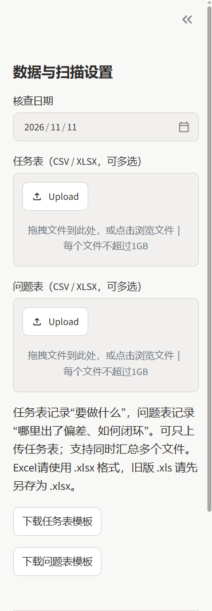
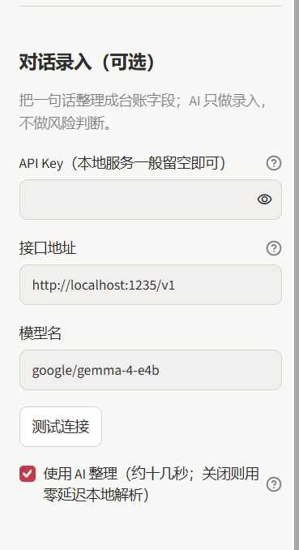
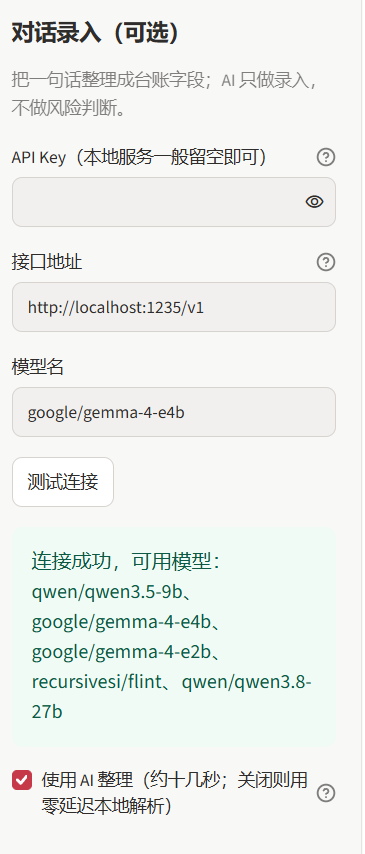
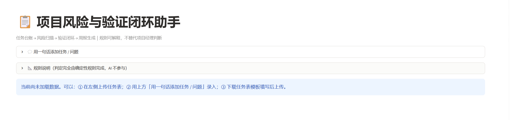
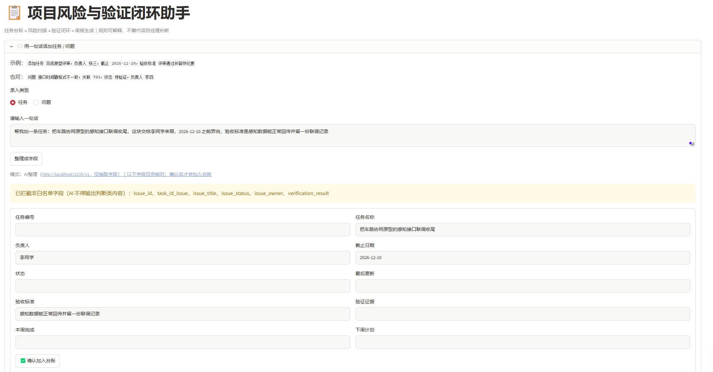
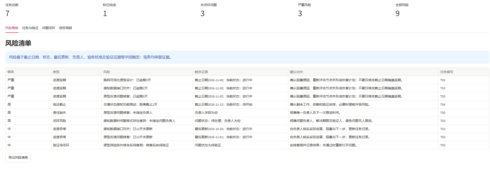

# 项目风险与验证闭环助手

> 面向项目助理、研发项目支持与交付场景：导入任务和问题记录，以明确规则识别延期、责任缺失、进度异常和验收风险，并生成可追溯的项目周报。

## 为什么做这个项目

研发项目中的延期与验证遗漏，往往不是因为完全缺乏记录，而是任务、问题和验收材料分散，风险依赖人工逐项检查。本工具把“任务台账—风险识别—验证闭环—周报”串成一个轻量流程。

这不是企业级项目管理系统。它辅助项目人员发现需要核实的问题，不自动修改任务、不代替项目经理决策。

## 核心功能

| 功能                     | 实现方式                                                                       |
| ------------------------ | ------------------------------------------------------------------------------ |
| CSV / XLSX任务与问题导入 | 支持多文件同时上传、中文编码兼容、来源追踪、重复编号提醒；下载模板为 `.xlsx` |
| 对话式录入               | 一句话整理成台账字段；不配 API Key 也能用本地解析                              |
| 可解释风险识别           | 逾期、临近截止、长期未更新、缺负责人、缺验收标准、缺验证证据                   |
| 规则说明面板             | 页面内展示全部 9 条规则的触发条件、依据字段与建议动作；定义与执行逻辑同源      |
| 问题闭环检查             | 未闭环问题缺负责人、修复待验证、问题与任务关联异常                             |
| 项目周报                 | 汇总本周完成、风险证据、建议动作和下周计划                                     |
| 结果导出                 | 风险清单 CSV、Markdown 周报                                                    |

## 风险判断原则

规则负责风险判断，结构化内容负责报告。每条预警展示触发证据和建议动作，不让大模型凭空判断项目状态。

- 未完成任务已逾期：严重风险；
- 未完成任务 3 天内到期：高风险；
- 进行中任务 7 天未更新：进度异常；
- 任务无负责人：责任缺失；
- 已完成但无验证证据：验收风险；
- 问题待处理但无负责人：闭环风险；
- 修复后待验证：验证待闭环。

完整逻辑见 `risk_rules.py`，对应测试见 `tests/test_risk_rules.py`。页面「📐 规则说明」面板由 `rule_descriptions()` 生成，阈值常量 `NEAR_DUE_DAYS` / `STALE_DAYS` 与执行代码共用，改规则时不会出现"说明与代码不一致"。

### AI 在哪里、不在哪里

项目里确实有 AI，但**只用于"输入"，永远不参与"判断"**：

| 环节                                     | 由谁做                              |
| ---------------------------------------- | ----------------------------------- |
| 把一句话整理成任务名、负责人、日期等字段 | AI（或本地解析器）                  |
| 提示"还缺负责人/截止日期/验收标准"       | AI 抽取后由代码比对字段             |
| 判断任务是否逾期、是否紧急、风险等级     | **确定性规则，AI 完全不参与** |
| 生成周报文字                             | 代码模板，不由 AI 撰写              |

具体约束见 `ai_intake.py`：提示词明确禁止输出"风险等级/优先级/是否紧急"等判断；`sanitize()` 用硬编码白名单过滤，即使模型返回越权字段也会被丢弃并在界面提示；解析结果需要**人工核对并点击确认**才进入台账；进入后仍由 `risk_rules.py` 的规则重新计算。

不填 API Key 也能使用 AI：只要 `config.toml` 指向本机 OpenAI 兼容服务（如 `http://localhost:1235/v1`），本地模型无需密钥即可调用；也可关闭「使用 AI 整理」走纯本地关键词/正则解析，项目完全离线可用。若模型超时或返回异常，会自动降级为本地解析，不会卡住录入。对话录入的记录只存在当前会话，刷新即清空，不写入文件。

## 本地模型选择（实测）

本项目把 AI 严格限制在「录入」环节：既能接本地部署的大模型，也能完全不加载模型、只用内置的本地解析器。两种方式的区别只在于能否理解模糊的口语表达，风险判断始终由规则完成。

对「一句话抽字段」这种不需要推理的任务，实测 5 个本机模型：

| 模型                   | 耗时  | 结果                                |
| ---------------------- | ----- | ----------------------------------- |
| `google/gemma-4-e4b` | 14.1s | ✅ 直接输出干净 JSON，已设为默认    |
| `google/gemma-4-e2b` | 17.9s | ❌ 结论写在 reasoning，content 为空 |
| `qwen/qwen3.5-9b`    | >75s  | ❌ 超时                             |
| `recursivesi/flint`  | 70.5s | ❌ content 为空                     |
| `qwen/qwen3.8-27b`   | 66.8s | ❌ content 为空                     |

推理型模型会把答案放进 `reasoning_content` 并长时间思考，不适合实时录入；E4B 是唯一既快又直接返回 JSON 的。`ai_intake.py` 也做了兼容：当 `content` 为空时尝试从 `reasoning_content` 末尾提取 JSON，便于以后更换模型。超时在 `config.toml` 中设为 35 秒。

### 三种录入方式

| 方式                               | 适用情况                                                | 是否需要模型                                        |
| ---------------------------------- | ------------------------------------------------------- | --------------------------------------------------- |
| **本地 AI 整理**（默认勾选） | 口语化表达，如「这块交给李同学来跟，下周三之前弄完」    | 需要本机运行 `http://localhost:1235/v1`，无需密钥 |
| **本地解析**（取消勾选）     | 规整句式，如「添加任务 …，负责人 …，截止 2026-11-20」 | 不需要，零延迟、完全离线                            |
| **云端 API**                 | 使用 OpenAI 等兼容服务                                  | 在侧栏填入 API Key 与接口地址                       |

本地解析依赖关键词与正则，句式越规整越准确；AI 模式负责理解模糊表达，但**两种模式都只做字段抽取，不参与风险判断**。点击「测试连接」可列出服务当前可用模型。API Key 的获取方式、本地模型的部署流程不在本项目范围内，故不展开。

## 快速开始（30 秒）

1. 启动应用后，在左侧上传 `sample_data/tasks.csv` 与 `sample_data/issues.csv`；
2. 将「核查日期」设为 `2026-11-10`；
3. 查看风险看板：6 个任务、4 条问题按 9 条规则生成 9 条带证据的预警；
4. 切到「项目周报」，下载 Markdown 报告；
5. 在「用一句话添加任务 / 问题」里输入一句话，体验字段抽取、人工确认与规则重算。

## 本地运行

需要 Python 3.10+。

```bash
# 进入项目文件夹
cd automotive-project-delivery-assistant

# 创建并启用虚拟环境（Windows）
python -m venv .venv
.venv\Scripts\activate

# 安装依赖
pip install -r requirements.txt

# 启动
python -m streamlit run app.py
```

浏览器打开终端显示的本地地址，通常为 `http://localhost:8501`。也可在配置好依赖后双击 `run_app.bat`。

无需注册账号、无需 API 密钥；上传文件仅在本机应用中处理。旧版 `.xls` 请另存为 `.xlsx`；CSV 支持 UTF-8、UTF-8 BOM、GB18030/GBK 等常见中文编码，并会校验表头，避免损坏文件被静默解成乱码。单个上传文件上限通过 `.streamlit/config.toml` 设为 1GB。

> **clone 后没有本地模型怎么办？** `config.toml` 中的地址与模型是作者本机配置。若本机未运行 `http://localhost:1235/v1`，「使用 AI 整理」会自动降级到零延迟的本地解析，其他功能不受影响；也可取消勾选该复选框，或把 `config.toml` 改成自己的服务地址。

## 实际运行界面

### 左侧「数据与扫描设置」

可设置核查日期、上传任务表与问题表（均支持多选），并下载两种 `.xlsx` 模板。数据来源既可以是 Excel/CSV 文件，也可以通过对话录入补充。



### 对话录入设置

可填写 API Key、接口地址与模型名。使用本地 OpenAI 兼容服务时**无需密钥**；点击「测试连接」会返回服务当前可用的模型列表。勾选「使用 AI 整理」调用本地模型（本项目默认 `google/gemma-4-e4b`），取消勾选则走零延迟的本地解析——因此无论是否加载模型，录入功能都可用。





### 起始页与规则说明

初始不加载任何数据，页面只显示录入入口、规则说明面板和操作提示。展开「📐 规则说明」可直接查看 9 条规则的触发条件、依据字段与建议动作，无需先造数据。



### 对话录入与人工确认

选择录入「任务」或「问题」，输入一句话后点击「整理成字段」，结果以可编辑表单展示；可补充或修改字段，核对无误后点击「✅ 确认加入台账」才会写入，并立即触发规则重算。图中黄色提示为**白名单拦截**：模型混入的问题表字段被自动丢弃，界面如实列出。



### 风险看板

载入示例数据后生成带触发证据与建议动作的风险清单，可导出为 CSV；「项目周报」标签页可下载 Markdown 报告。示例数据仅用于功能演示，不代表真实项目。



## 三分钟演示

1. 初始页面不加载数据；下载任务表模板，或在侧栏上传 `sample_data/tasks.csv` 与 `sample_data/issues.csv`（也可上传已生成的 `.xlsx` 模板）；也可在「用一句话添加任务 / 问题」中输入一句话录入；
2. 将「核查日期」设为 `2026-11-10`，在风险看板查看逾期、临近截止、长期未更新及验收风险；
3. 展开每条风险的触发证据与建议动作；
4. 在「任务与验证」对照原始任务记录；
5. 在「问题闭环」查看待处理、待验证问题；
6. 在「项目周报」下载 Markdown 报告；
7. 上传按模板修改的 CSV 或 Excel，展示工具并非只能处理固定示例。

## 任务表与问题表

任务表记录“谁在何时交付什么、怎样算完成”；问题表记录“出现什么偏差、谁处理、修复后如何验证”。字段说明及填写示例见[任务表与问题表说明](docs/任务表与问题表说明.md)。

## 数据说明与边界

`sample_data/` 中的任务、人名和管理记录是为功能演示构造的模拟数据，场景来自个人车路协同项目，不代表当时真实节点，也不代表企业项目数据。

工具只检查「验证证据」字段是否存在，不会自动验证证据内容。报告中的建议需要项目负责人确认。当前版本不含登录、多用户权限、自动消息推送及真实 Jira/Trello 集成。

### 设计取舍

| 取舍                             | 原因                                                                                                                    |
| -------------------------------- | ----------------------------------------------------------------------------------------------------------------------- |
| 风险判断用确定性规则，不用大模型 | 风险结论要拿去与人对齐、要复核；同样的表格与核查日期必须得到完全相同的结果。AI 适合整理和表达，不适合替项目经理下判断。 |
| 「完成」不等于「验证通过」       | 任务标记已完成但缺验证证据、问题修复后仍为「待验证」都会被列为风险，对应真实项目里最常见的闭环遗漏。                    |
| AI 只做录入，且需人工确认        | 最坏情况是字段没抽全，不会产生一条假风险；白名单、人工确认、规则引擎构成三层看管。                                      |
| 示例数据使用模拟数据             | 避免把校园项目或企业经历包装成真实项目，也便于他人直接复现。                                                            |
| 对话录入只在当前会话生效         | 保持「纯本地、不落盘、不替用户改文件」的简化定位；持久化属于后续迭代。                                                  |
| 规则定义与界面说明同源           | `rule_descriptions()` 与 `scan_project()` 共用阈值常量，改规则时不会出现说明与代码漂移。                            |

## 项目结构

```text
├── app.py                  # Streamlit 网页与页面流程
├── risk_rules.py           # 可解释风险规则、阈值常量、规则说明
├── data_io.py              # CSV/Excel 导入、编码识别、xlsx 模板生成
├── ai_intake.py            # 对话录入：只抽取字段，不判断风险
├── report_generator.py     # Markdown 周报
├── config.toml             # 本地模型服务地址、模型名、超时
├── .streamlit/config.toml  # 上传文件大小上限
├── sample_data/            # 模拟数据与 xlsx 模板
├── image/README/           # README 截图
├── docs/                   # 需求说明、演示稿、字段说明
├── tests/                  # 40 项自动测试
├── requirements.txt
├── run_app.bat
└── README.md
```

## 运行测试

```bash
python -m unittest discover -s tests -v
```

## 后续迭代

- 增加风险规则配置与风险处理状态；
- 支持实际验证证据上传与评审记录；
- 对接 Jira / 飞书项目前，先明确数据权限及隐私边界；
- AI 继续限定在录入/整理环节；周报润色若引入模型，仍不得改变规则计算出的风险结论。
